# SwiftMask-CES

## Cost-Efficient Segmentation under a Compute Budget

This project builds a compact foreground/background segmentation model optimized for the assignment constraints: low CPU inference time, small model size, and strong quality metrics. The final model is a lightweight U2-inspired residual architecture designed to balance segmentation precision with computational efficiency.

## Project overview

- Final model checkpoint: [models/final/swiftmask_u2_v2.pt](models/final/swiftmask_u2_v2.pt)
- Best validation threshold: 0.55
- Trainable parameters: 43,689
- Validation CES: 0.739036
- Benchmark CES: 0.733409
- Captured-image CES: 0.564096

## Architecture

The final architecture is a compact residual encoder-decoder network with depthwise separable convolutions, skip connections, and multi-scale context aggregation.


## Model explanation

The model follows a lightweight U2-style segmentation pattern, but with a much smaller footprint than a full large-capacity U-Net or FCN baseline. The design is intentionally compact to satisfy the assignment constraints while preserving strong segmentation quality.

- Input stem: begins with a small convolutional front-end to extract low-level spatial features while keeping computation lightweight.
- Residual blocks: repeated residual units preserve gradient flow and help the network learn meaningful object structure without exploding parameter count.
- Depthwise separable convolutions: reduce the number of parameters and multiply-add operations compared with standard convolutions, making the model faster and smaller.
- Skip connections: features from earlier encoder stages are fused with decoder representations to recover object boundaries and spatial detail.
- Multi-scale context: the bottleneck aggregates information at multiple receptive-field scales, which improves the network's ability to segment foreground objects of varying sizes and shapes.
- Decoder and mask head: progressively upsamples the compressed features, combines them with high-resolution spatial cues, and produces a final binary mask.
- Thresholding: the final score map is converted to a binary mask using a fixed confidence threshold of 0.55 for deployment.

This architecture is a practical tradeoff: it keeps the network compact and efficient, while still capturing enough semantic and boundary information to produce strong CES and mIoU values on validation data.

## Final model summary

- Architecture: compact U2-inspired residual segmentation model
- Input size: 256 x 256 RGB
- Output: binary foreground mask
- Final threshold: 0.55
- Model size: 290,947 bytes
- Average benchmark CPU time: 21.41 ms/image

## Validation results

### Best threshold selection

The model was evaluated across a threshold sweep to select the best operating point.

| Threshold | mIoU | Boundary F1 | Quality Q | CES |
|---|---:|---:|---:|---:|
| 0.35 | 0.865410 | 0.658327 | 0.803285 | 0.733076 |
| 0.40 | 0.867565 | 0.663406 | 0.806317 | 0.735843 |
| 0.45 | 0.869058 | 0.666577 | 0.808314 | 0.737665 |
| 0.50 | 0.870070 | 0.668304 | 0.809540 | 0.738785 |
| 0.55 | 0.870597 | 0.667994 | 0.809816 | 0.739036 |
| 0.60 | 0.870559 | 0.665822 | 0.809138 | 0.738417 |

### Best validation result

- mIoU: 0.870597
- Boundary F1: 0.667994
- Quality Q: 0.809816
- CES: 0.739036

### Validation benchmark

Under single-thread CPU benchmark evaluation:

- Average CPU time: 21.41 ms/image
- Model size: 290,947 bytes
- mIoU: 0.869044
- Boundary F1: 0.666302
- CES: 0.733409

## Training and analysis plots

### Training history


### Threshold sweep


### Captured summary

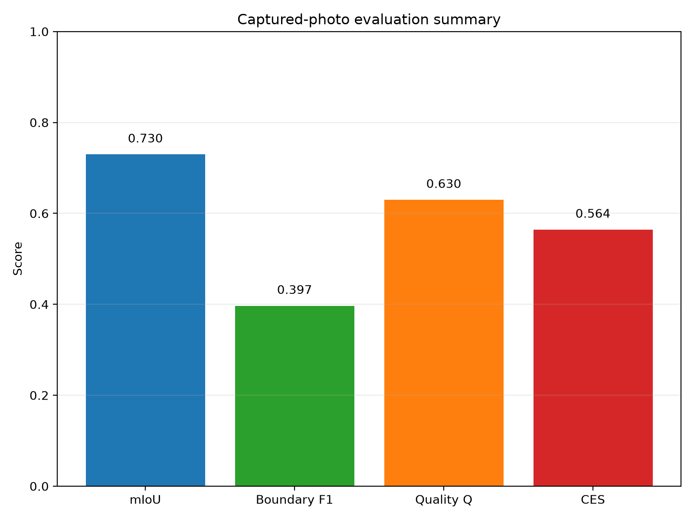

## Captured-image evaluation

The model was evaluated on real captured examples to test robustness under practical photography conditions.

- mIoU: 0.729609
- Boundary F1: 0.396546
- Average CPU time: 24.31 ms/image
- CES: 0.564096

### Captured comparison examples

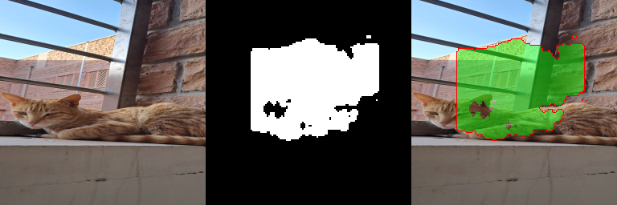
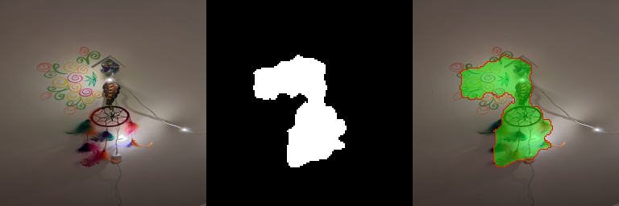
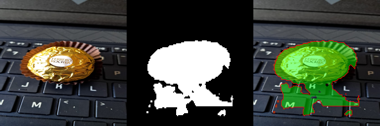

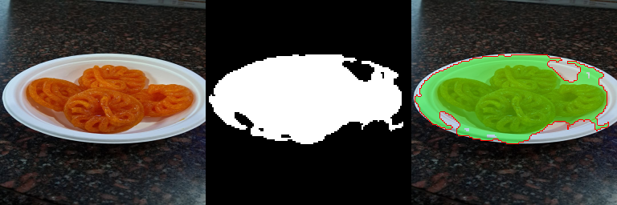
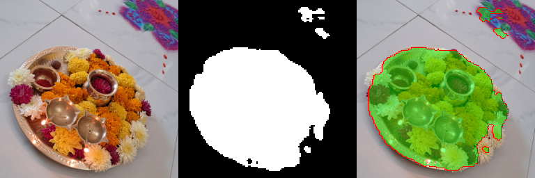
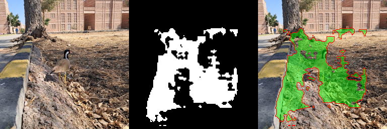

## Validation visualizations

The following validation visual comparisons show original images, ground-truth masks, predicted masks, and overlay error maps.


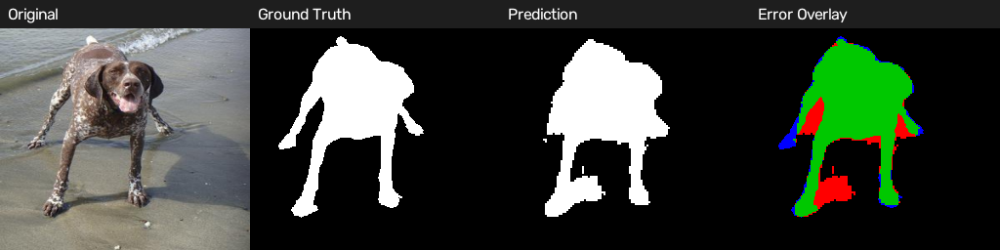
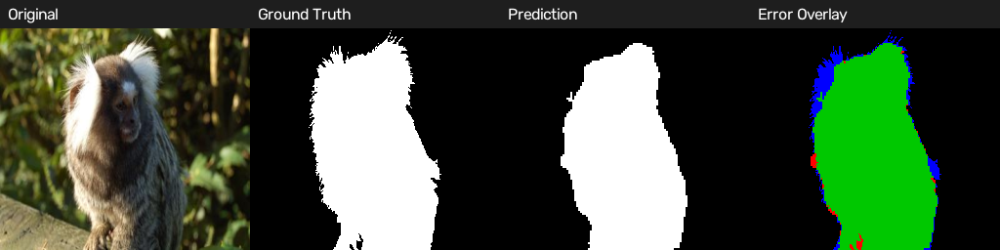
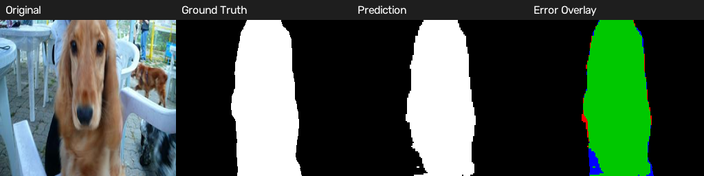
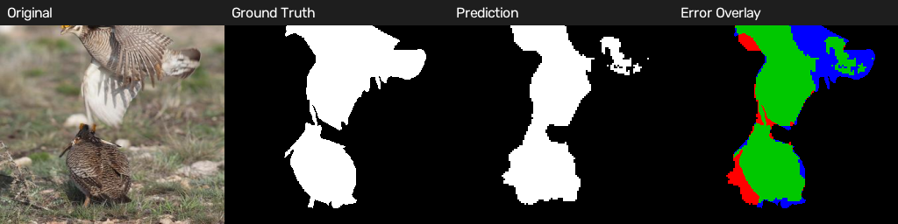
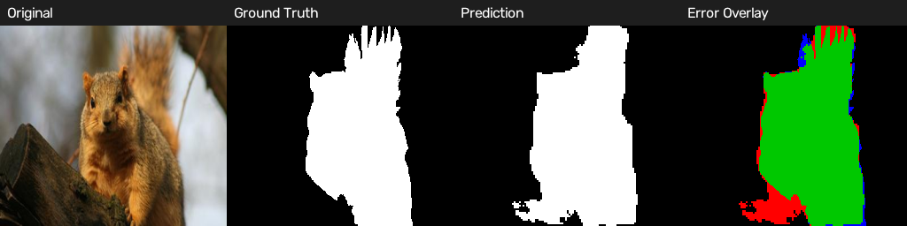
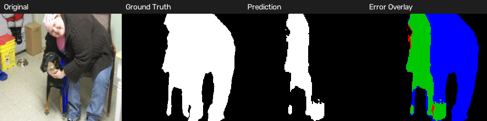
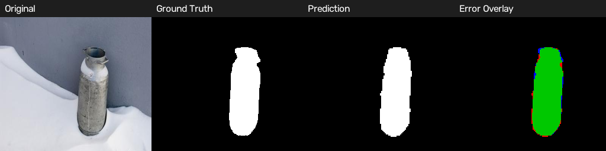
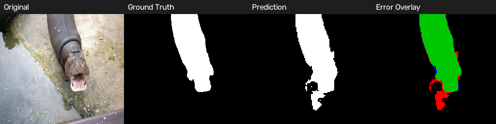

## Why this model was chosen

The earlier larger FCN-style design showed promising raw accuracy, but it violated the practical project constraints because of its higher compute cost and larger footprint. The final compact model is a better tradeoff for the actual assignment objective: strong segmentation quality while remaining within the CPU and size constraints.

## Limitations

- Captured-image performance is noticeably lower than validation performance because real-world scenes are more variable and less controlled.
- Boundary F1 is weaker than mIoU in some cases, which is typical for foreground segmentation tasks with thin or irregular object boundaries.
- The model is deliberately lightweight, so it is not the highest-capacity architecture for every segmentation scenario.
- The project prioritizes cost-efficient segmentation under the assignment constraints rather than maximum network complexity alone.

## Deliverables

- Final trained checkpoint: [models/final/swiftmask_u2_v2.pt](models/final/swiftmask_u2_v2.pt)
- Final project report: [reports/final_report.md](reports/final_report.md)
- Training and summary figures: [reports/figures/v2](reports/figures/v2)
- Validation benchmark results: [outputs/logs/val_benchmark.json](outputs/logs/val_benchmark.json)
- Best threshold analysis: [outputs/logs/threshold_optimization/best_threshold.json](outputs/logs/threshold_optimization/best_threshold.json)
- Threshold comparison CSV: [outputs/logs/threshold_optimization/threshold_comparison.csv](outputs/logs/threshold_optimization/threshold_comparison.csv)
- Captured evaluation results: [outputs/captured_evaluation/captured_results.json](outputs/captured_evaluation/captured_results.json)
- Validation visual comparisons: [outputs/visualizations/validation](outputs/visualizations/validation)

## Repository structure

- [src/ces](src/ces): model, dataset loader, preprocessing, and pipeline code
- [scripts](scripts): training, evaluation, benchmarking, and visualization utilities
- [models](models): trained checkpoints and final model
- [outputs](outputs): all logs, masks, predictions, and evaluation artifacts
- [reports](reports): summary plots and final report
- [tests](tests): unit tests and validation checks

## Reproduction commands

```bash
export PYTHONPATH=src
./.venv/bin/python scripts/train_v2.py
./.venv/bin/python scripts/evaluate.py
./.venv/bin/python scripts/benchmark.py
./.venv/bin/python scripts/evaluate_captured.py
```

## Conclusion

This final compact model delivers strong segmentation quality while satisfying the assignment constraints. It is the most suitable practical solution for the project objective: maintain high CES performance without sacrificing time efficiency or model size.