# SwiftMask-CES

## Cost-Efficient Segmentation under a Compute Budget

**Course:** CSL7360 — Computer Vision, Assignment 2  
**Track:** B — Fully Convolutional Network trained from scratch

SwiftMask-CES is a lightweight foreground/background segmentation system designed to balance segmentation quality, boundary accuracy, CPU inference time, and saved model size. The currently tracked implementation is a compact **U²-Net-inspired residual encoder–decoder** with depthwise-separable convolutions, skip connections, and a dilated multi-scale context block.

> **Version and benchmark note:** This README describes files currently tracked on `main`. The active checkpoint is `models/final/swiftmask_u2_v2.pt` (290,947 bytes), and the active inference threshold in `src/ces/config.py` is 0.55. The checked-in `outputs/logs/test_benchmark.json` is an older run (66.7893 ms/image and a 1,115,047-byte checkpoint); it does **not** describe the current checkpoint and does not satisfy the 50 ms requirement. A current-checkpoint DUTS-TE benchmark is still required before publishing an official final DUTS-TE CES.

## Contents

1. [Objective and constraints](#1-objective-and-constraints)
2. [Dataset and preprocessing](#2-dataset-and-preprocessing)
3. [Network architecture](#3-network-architecture)
4. [Training methodology](#4-training-methodology)
5. [Evaluation protocol](#5-evaluation-protocol)
6. [Validation and threshold selection](#6-validation-and-threshold-selection)
7. [DUTS-TE benchmark status](#7-duts-te-benchmark-status)
8. [Captured-photo evaluation](#8-captured-photo-evaluation)
9. [Failure analysis](#9-failure-analysis)
10. [Inference and reproduction](#10-inference-and-reproduction)
11. [Repository structure](#11-repository-structure)

---

## 1. Objective and constraints

For an input photograph, predict a binary mask that labels every pixel as either the main foreground object or background.

- Foreground: 1 in memory and 255 in saved PNG masks.
- Background: 0 in memory and 0 in saved PNG masks.
- Average CPU process time: at most **50 ms/image**, measured on one CPU core.
- Saved parameter file: at most **4 MiB = 4,194,304 bytes**.
- Quality combines aggregate mIoU and mean per-image Boundary F1.
- CES applies the assignment's latency and model-size penalties to Q.

### Current tracked model

| Property | Value |
|---|---:|
| Architecture | Compact U²-Net-inspired residual encoder–decoder |
| Checkpoint | `models/final/swiftmask_u2_v2.pt` |
| Trainable parameters | 43,689 |
| CNN working resolution | 128 × 128 |
| Output / metric resolution | 256 × 256 |
| Inference threshold | **0.55** |
| Checkpoint size | **290,947 bytes (0.277 MiB)** |
| CPU threads | 1 |

The architecture is U²-Net-inspired; it is a deliberately smaller custom network, not the full original U²-Net.

## 2. Dataset and preprocessing

### 2.1 DUTS split

DUTS-TR supplies the training and validation examples. DUTS-TE is reserved for final evaluation and is not loaded by the training loop.

| Split | Images | Purpose |
|---|---:|---|
| DUTS-TR | 10,553 | Training/validation source |
| Training subset | 9,497 | Parameter optimization |
| Validation subset | 1,056 | Model assessment and threshold selection |
| DUTS-TE | 5,019 | Official test benchmark |

The project uses a 90:10 training/validation split with random seed 42. Processed data is expected under `data/processed/DUTS/train` and `data/processed/DUTS/val`.

### 2.2 Preprocessing

The assignment specifies resizing photographs to **256 × 256** with OpenCV `INTER_AREA`, and masks to **256 × 256** with `INTER_NEAREST`. A mask pixel is foreground when its grayscale value is at least 128. Non-square images are directly resized to the square target, as required by the assignment.

Training uses 128 × 128 model inputs to reduce computation. In inference, a 256 × 256 BGR image is converted to RGB, resized to 128 × 128, normalized to [0, 1], and converted to a tensor. The network output is thresholded and returned as a 256 × 256 binary mask.

### 2.3 Training augmentation

Augmentation is enabled for training and disabled for validation. Paired images and masks receive the same geometric transformations (flips and scale changes); image-only appearance transformations vary brightness/contrast and channel gains. Mask transformations use nearest-neighbour interpolation to preserve discrete labels.

### 2.4 Captured photographs

Ten phone photographs were collected around campus/hostel and annotated with LabelMe polygons. They cover everyday objects and varied scene conditions, including indoor/outdoor settings, different lighting, small and large objects, and clutter.

The captured evaluation currently uses **nine aligned image/mask pairs**. **img2.png (the wall hanging/dreamcatcher image) is excluded** because its crop-to-mask alignment was not considered reliable. It is not included in captured metrics or the comparison-image gallery.

Expected layout:

```text
captured/
├── original/       # phone photographs and LabelMe JSON annotations
├── images 256/     # 256 x 256 images
└── masks 256/      # binary masks: background=0, foreground=255
```

Captured photographs are for testing only; they are not used for model training or threshold selection.

## 3. Network architecture

The active model is implemented in `src/ces/methods/track_b/model.py`.

### 3.1 Depthwise-separable convolution

Each block applies a 3 × 3 depthwise spatial convolution, batch normalization and ReLU, followed by a 1 × 1 pointwise channel-mixing convolution, batch normalization and ReLU. This reduces computation and parameter count compared with repeatedly using full dense 3 × 3 convolutions.

### 3.2 Residual U-blocks

Each RSU block projects its input to the required output width, extracts features through depthwise-separable convolutions, downsamples with max pooling, upsamples with bilinear interpolation, concatenates an encoder feature, and refines the fused representation. A projected residual is added to the decoded result.

### 3.3 Encoder, context block and decoder

| Stage | Channels | Purpose |
|---|---:|---|
| Encoder 1 | 16 | Fine spatial features |
| Encoder 2 | 24 | Intermediate features |
| Encoder 3 | 40 | Deeper semantic features |
| Bottleneck | 56 | Multi-scale context |
| Decoder 3 | 40 | Skip fusion with encoder 3 |
| Decoder 2 | 24 | Skip fusion with encoder 2 |
| Decoder 1 | 16 | Skip fusion with encoder 1 |
| Output head | 1 | Foreground logits |

The bottleneck has three parallel depthwise-separable branches with dilation rates **1, 2, and 4**. Their outputs are concatenated, projected, and combined with a residual projection. The decoder progressively upsamples and concatenates skip features from the encoder. A final 1 × 1 convolution produces the one-channel foreground logit map.

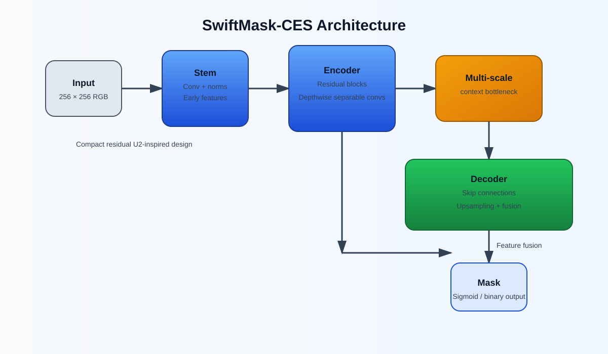

## 4. Training methodology

Training is implemented in `scripts/train_v2.py`. The active V2 checkpoint is trained from scratch on DUTS-TR; no pretrained segmentation weights or pretrained backbone are used.

| Hyperparameter | Value |
|---|---:|
| Epochs | 40 |
| Input resolution | 128 × 128 |
| Batch size | 16 |
| Optimizer | AdamW |
| Learning rate | 0.001 |
| Weight decay | 0.00001 |
| Loss | Binary cross-entropy + Soft Dice |
| Augmentation | Training split only |
| Random seed | 42 |
| Device | CUDA when available |

The training and validation history is stored in `outputs/logs/v2/training_history_v2.json`.

### Training history and threshold sweep

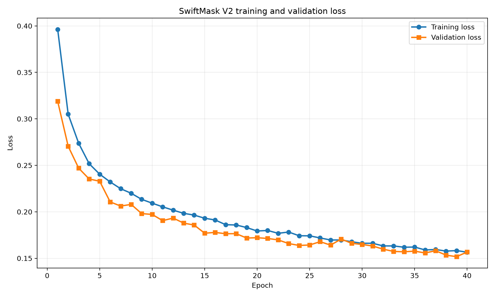

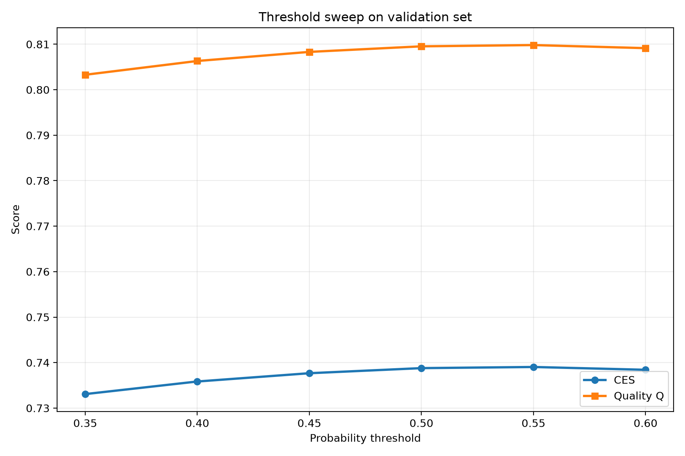

## 5. Evaluation protocol

### 5.1 Timed inference

The timed function starts with a 256 × 256 BGR photograph already in memory and ends with a 256 × 256 binary prediction in memory. It includes colour conversion, resizing to model resolution, normalization, tensor construction, model forward pass, sigmoid/thresholding, and output materialization. Checkpoint loading, source-file I/O, original-file resizing, metric calculation, and visualization writing are outside the timed function.

CPU evaluation configures one PyTorch and one OpenCV thread and performs a warm-up inference before timing. Average CPU time is measured using `time.process_time()`.

### 5.2 Mean intersection over union

A single dataset-level 2 × 2 confusion matrix is accumulated:

```text
IoU_fg = TP / (TP + FP + FN)
IoU_bg = TN / (TN + FP + FN)
mIoU   = (IoU_fg + IoU_bg) / 2
```

This is the average of foreground and background IoU computed from the aggregate confusion matrix.

### 5.3 Boundary F1

A boundary pixel is a foreground pixel with at least one background neighbour in its four-connected neighbourhood; pixels outside the image count as background. A predicted boundary pixel is considered matched if a ground-truth boundary pixel lies within its 5 × 5 neighbourhood. The reverse match gives recall. Precision and recall are combined using the harmonic mean. Boundary F1 is computed per image and then averaged.

### 5.4 Quality and CES

```text
Q = 0.70 * mIoU + 0.30 * BoundaryF1

CES = Q * [1 - 0.20 * (T_CPU / 50 ms)
             - 0.10 * min(1, S_disk / 4 MiB)]
```

CES is zero when average CPU time exceeds 50 ms. The model-size term uses the exact serialized parameter-file size in bytes.

## 6. Validation and threshold selection

Six thresholds were compared on the **1,056-image validation split**. The threshold sweep selected the threshold with the highest validation CES estimate. The sweep uses a previously measured CPU reference of 20.116461 ms/image and the active checkpoint size of 290,947 bytes.

| Threshold | mIoU | Boundary F1 | Q | CES |
|---:|---:|---:|---:|---:|
| 0.35 | 0.865410 | 0.658327 | 0.803285 | 0.733076 |
| 0.40 | 0.867565 | 0.663406 | 0.806317 | 0.735843 |
| 0.45 | 0.869058 | 0.666577 | 0.808314 | 0.737665 |
| 0.50 | 0.870070 | 0.668304 | 0.809540 | 0.738785 |
| **0.55** | **0.870597** | **0.667994** | **0.809816** | **0.739036** |
| 0.60 | 0.870559 | 0.665822 | 0.809138 | 0.738417 |

**Selected validation threshold: 0.55.** The selected value is stored in `src/ces/config.py` and used by `src/ces/pipeline.py`.

The separate saved validation CPU benchmark (`outputs/logs/val_benchmark.json`) records 1,056 images, 21.4071 ms/image, 290,947 bytes, mIoU 0.869044, Boundary F1 0.666302, Q 0.808222, and CES 0.733409. That JSON records threshold 0.50, so it is a distinct benchmark record from the threshold-sweep best row above.

## 7. DUTS-TE benchmark status

The committed `outputs/logs/test_benchmark.json` is a **legacy benchmark artifact**, not a final result for the currently tracked checkpoint. It records:

| Field in legacy JSON | Value |
|---|---:|
| Threshold | 0.50 |
| Average CPU time | 66.7893 ms/image |
| Model size | 1,115,047 bytes |
| mIoU | 0.671971 |
| Boundary F1 | 0.398054 |
| Q | 0.589796 |
| CES | 0.000000 |

The file's model size and timing do not match the active 290,947-byte checkpoint and current 0.55 configuration; its CPU time also exceeds the assignment limit. Therefore, **no official current-checkpoint DUTS-TE CES is claimed in this README yet**.

Run the benchmark with the current checkpoint/configuration before reporting the final official score:

```fish
uv run python scripts/benchmark.py --split test
```

Do not tune the model or threshold based on DUTS-TE results.

## 8. Captured-photo evaluation

The current captured evaluation uses **nine valid image/mask pairs** and the active 290,947-byte checkpoint. The aggregate results are taken from `outputs/captured_evaluation/captured_results.json`.

| Metric | Result |
|---|---:|
| Images evaluated | 9 |
| Foreground IoU | 0.719970 |
| Background IoU | 0.739249 |
| **Aggregate mIoU** | **0.729609** |
| Mean per-image Boundary F1 | 0.396546 |
| **Quality Q** | **0.629690** |
| Average CPU time | 24.3081 ms/image |
| Model size | 290,947 bytes |
| Supplementary captured CES | 0.564096 |

The captured-photo CES is supplementary; it does not replace the official DUTS-TE CES.

### Per-image results

| Image | mIoU | Boundary F1 | CPU ms |
|---|---:|---:|---:|
| img1.png | 0.614361 | 0.238286 | 26.32 |
| img10.png | 0.750843 | 0.312956 | 26.45 |
| img3.png | 0.890940 | 0.587340 | 26.17 |
| img4.png | 0.543074 | 0.172663 | 22.65 |
| img5.png | 0.949522 | 0.771009 | 21.47 |
| img6.png | 0.382896 | 0.086616 | 21.60 |
| img7.png | 0.911785 | 0.646296 | 24.51 |
| img8.png | 0.877011 | 0.541496 | 27.52 |
| img9.png | 0.596207 | 0.212255 | 22.08 |

### Captured comparison images — one horizontal row of four panels per image

Each comparison is a **single horizontal strip** in this order: Original Image | Ground Truth | Prediction | Overlay. The images below are shown one per line so that all four panels remain readable. Image 2 is omitted because its mask alignment is uncertain.

<p align="center"><strong>img1.png</strong></p>
<p align="center">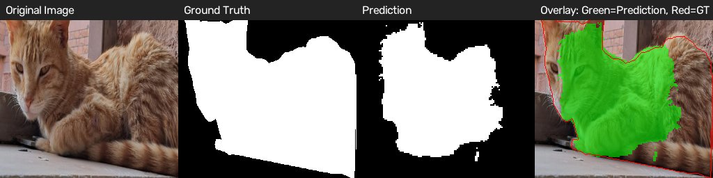</p>

<p align="center"><strong>img3.png</strong></p>
<p align="center">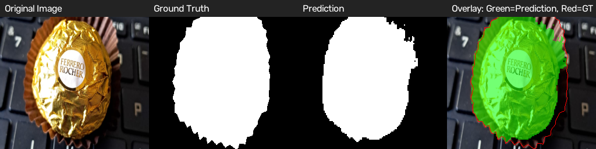</p>

<p align="center"><strong>img4.png</strong></p>
<p align="center">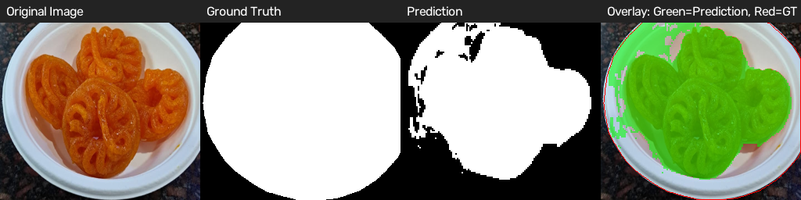</p>

<p align="center"><strong>img5.png</strong></p>
<p align="center">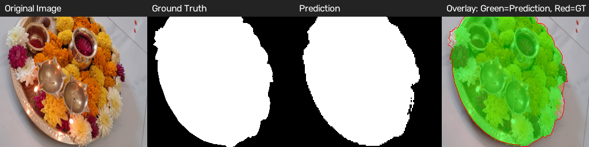</p>

<p align="center"><strong>img6.png</strong></p>
<p align="center">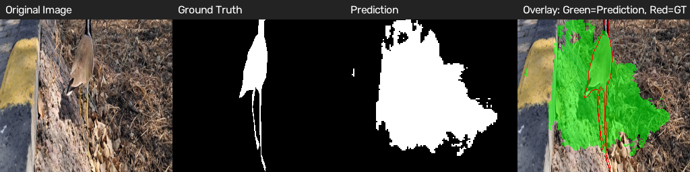</p>

<p align="center"><strong>img7.png</strong></p>
<p align="center">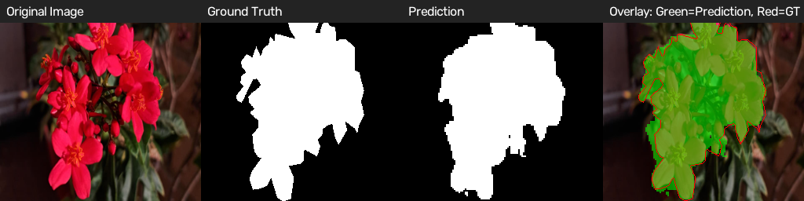</p>

<p align="center"><strong>img8.png</strong></p>
<p align="center">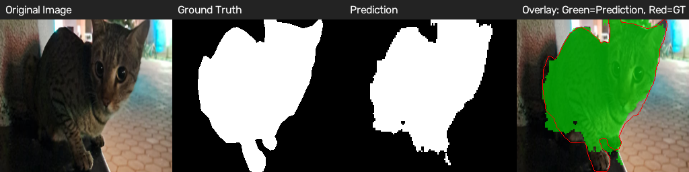</p>

<p align="center"><strong>img9.png</strong></p>
<p align="center">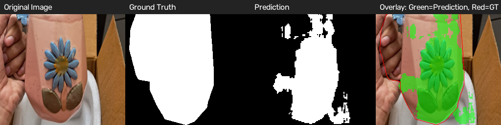</p>

<p align="center"><strong>img10.png</strong></p>
<p align="center">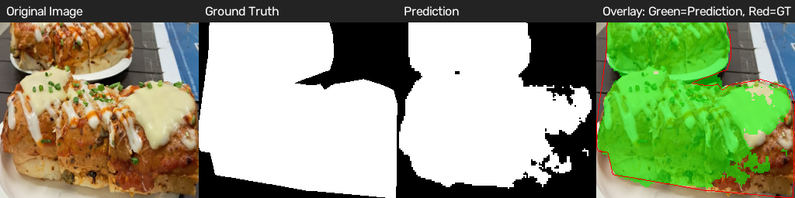</p>

### Validation comparison examples

The validation visualizer also creates a four-panel horizontal strip. A few examples from the held-out DUTS validation split are included below.

<p align="center"><strong>Validation example 1</strong></p>
<p align="center">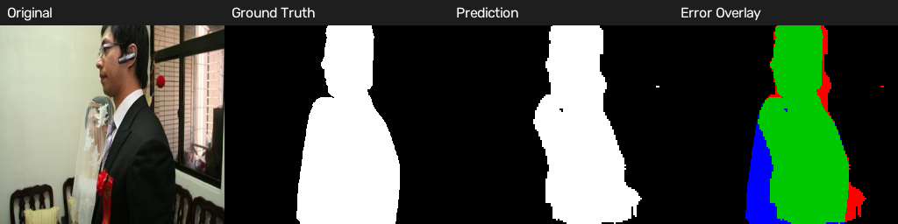</p>

<p align="center"><strong>Validation example 2</strong></p>
<p align="center">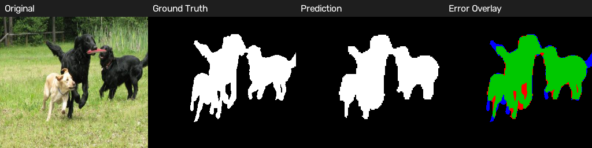</p>

<p align="center"><strong>Validation example 3</strong></p>
<p align="center">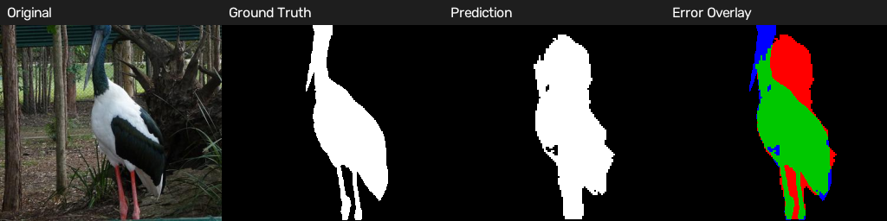</p>

<p align="center"><strong>Validation example 4</strong></p>
<p align="center">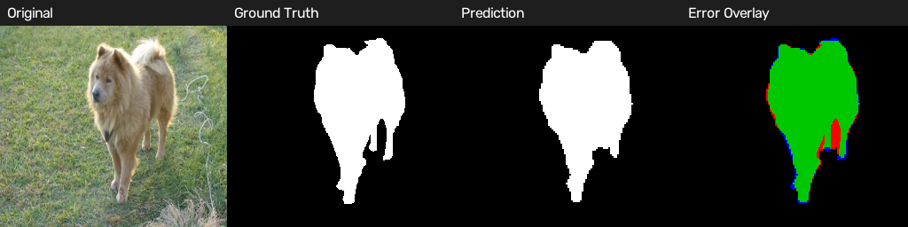</p>

### Captured evaluation artifacts

- Predictions: `outputs/captured_evaluation/predictions/`
- Overlays: `outputs/captured_evaluation/overlays/`
- Comparison panels: `outputs/captured_evaluation/comparisons/`
- Aggregate JSON: `outputs/captured_evaluation/captured_results.json`
- Per-image CSV: `outputs/captured_evaluation/per_image_results.csv`

## 9. Failure analysis

The captured results illustrate how scene complexity and object scale affect a compact segmentation network.

- **img6.png — bird:** weakest captured example (mIoU 0.382896, Boundary F1 0.086616). The bird is relatively small against a complex outdoor background. Thin legs and fine contour details are difficult to recover after reducing the input to 128 × 128.
- **img4.png — jalebi:** mIoU 0.543074 and Boundary F1 0.172663. The irregular, overlapping loops and ambiguous boundaries against the plate make accurate contour localization difficult.
- **img1.png and img9.png:** Boundary F1 is 0.238286 and 0.212255 respectively. These examples show that acceptable region overlap does not necessarily imply precise boundaries.

These are qualitative interpretations of the captured examples and their measured per-image results.

## 10. Inference and reproduction

### Environment

The project uses Python 3.12 and `uv`. Training uses CUDA when available. CPU benchmarks and captured evaluation use one CPU thread.

Install the environment:

```fish
uv sync
```

### Train V2

Ensure the processed DUTS training and validation splits exist, then run:

```fish
uv run python scripts/train_v2.py
```

### Evaluate validation thresholds

```fish
uv run python scripts/evaluate.py
```

The threshold comparison is written to `outputs/logs/threshold_optimization/`. The selected threshold (0.55) is stored in `src/ces/config.py`.

### Run the current DUTS-TE CPU benchmark

```fish
uv run python scripts/benchmark.py --split test
```

### Evaluate captured photographs

Ensure each included 256 × 256 image has a corresponding binary mask with the same basename. Exclude image 2 while its crop/mask alignment remains uncertain.

```fish
uv run python scripts/evaluate_captured.py
```

### Predict one image

```fish
uv run python predict.py --image path/to/photo.jpg --out outputs/prediction.png
```

The command loads the checkpoint, saves a 256 × 256 mask PNG (0/255), and prints the required CPU-time and model-size lines.

## 11. Repository structure

```text
swiftmask-ces/
├── captured/
│   ├── original/
│   ├── images 256/
│   └── masks 256/
├── data/
│   ├── raw/
│   ├── processed/
│   └── splits/
├── models/
│   ├── checkpoints/
│   └── final/
│       └── swiftmask_u2_v2.pt
├── outputs/
│   ├── captured_evaluation/
│   └── logs/
├── reports/
│   ├── figures/
│   └── final_report.md
├── scripts/
│   ├── train_v2.py
│   ├── evaluate.py
│   ├── benchmark.py
│   └── evaluate_captured.py
├── src/
│   └── ces/
│       ├── config.py
│       ├── data_loader.py
│       ├── pipeline.py
│       ├── metrics/
│       └── methods/track_b/
└── predict.py
```

### Important result files

- [Current configuration](src/ces/config.py)
- [V2 model](src/ces/methods/track_b/model.py)
- [Training script](scripts/train_v2.py)
- [Threshold comparison](outputs/logs/threshold_optimization/threshold_comparison.json)
- [Selected threshold](outputs/logs/threshold_optimization/best_threshold.json)
- [Validation benchmark](outputs/logs/val_benchmark.json)
- [Legacy DUTS-TE benchmark (not current)](outputs/logs/test_benchmark.json)
- [Captured evaluation JSON](outputs/captured_evaluation/captured_results.json)
- [Captured per-image metrics](outputs/captured_evaluation/per_image_results.csv)
- [Final report](reports/final_report.md)

---

## Conclusion

SwiftMask-CES uses a compact residual encoder–decoder with depthwise-separable convolutions and multi-scale context to target cost-efficient binary segmentation. The currently tracked model has 43,689 parameters and a 290,947-byte checkpoint. Validation threshold selection and a nine-image captured-photo evaluation are documented above. The old DUTS-TE benchmark artifact does not correspond to the current model, so the official test benchmark must be rerun before claiming a final DUTS-TE CES.# SwiftMask-CES

## Cost-Efficient Segmentation under a Compute Budget

**Course:** CSL7360 — Computer Vision, Assignment 2  
**Track:** B — Fully Convolutional Network trained from scratch

SwiftMask-CES is a lightweight foreground/background segmentation system designed to balance segmentation quality, boundary accuracy, CPU inference time, and saved model size. The currently tracked implementation is a compact **U²-Net-inspired residual encoder–decoder** with depthwise-separable convolutions, skip connections, and a dilated multi-scale context block.

> **Version and benchmark note:** This README describes files currently tracked on `main`. The active checkpoint is `models/final/swiftmask_u2_v2.pt` (290,947 bytes), and the active inference threshold in `src/ces/config.py` is 0.55. The checked-in `outputs/logs/test_benchmark.json` is an older run (66.7893 ms/image and a 1,115,047-byte checkpoint); it does **not** describe the current checkpoint and does not satisfy the 50 ms requirement. A current-checkpoint DUTS-TE benchmark is still required before publishing an official final DUTS-TE CES.

## Contents

1. [Objective and constraints](#1-objective-and-constraints)
2. [Dataset and preprocessing](#2-dataset-and-preprocessing)
3. [Network architecture](#3-network-architecture)
4. [Training methodology](#4-training-methodology)
5. [Evaluation protocol](#5-evaluation-protocol)
6. [Validation and threshold selection](#6-validation-and-threshold-selection)
7. [DUTS-TE benchmark status](#7-duts-te-benchmark-status)
8. [Captured-photo evaluation](#8-captured-photo-evaluation)
9. [Failure analysis](#9-failure-analysis)
10. [Inference and reproduction](#10-inference-and-reproduction)
11. [Repository structure](#11-repository-structure)

---

## 1. Objective and constraints

For an input photograph, predict a binary mask that labels every pixel as either the main foreground object or background.

- Foreground: 1 in memory and 255 in saved PNG masks.
- Background: 0 in memory and 0 in saved PNG masks.
- Average CPU process time: at most **50 ms/image**, measured on one CPU core.
- Saved parameter file: at most **4 MiB = 4,194,304 bytes**.
- Quality combines aggregate mIoU and mean per-image Boundary F1.
- CES applies the assignment's latency and model-size penalties to Q.

### Current tracked model

| Property | Value |
|---|---:|
| Architecture | Compact U²-Net-inspired residual encoder–decoder |
| Checkpoint | `models/final/swiftmask_u2_v2.pt` |
| Trainable parameters | 43,689 |
| CNN working resolution | 128 × 128 |
| Output / metric resolution | 256 × 256 |
| Inference threshold | **0.55** |
| Checkpoint size | **290,947 bytes (0.277 MiB)** |
| CPU threads | 1 |

The architecture is U²-Net-inspired; it is a deliberately smaller custom network, not the full original U²-Net.

## 2. Dataset and preprocessing

### 2.1 DUTS split

DUTS-TR supplies the training and validation examples. DUTS-TE is reserved for final evaluation and is not loaded by the training loop.

| Split | Images | Purpose |
|---|---:|---|
| DUTS-TR | 10,553 | Training/validation source |
| Training subset | 9,497 | Parameter optimization |
| Validation subset | 1,056 | Model assessment and threshold selection |
| DUTS-TE | 5,019 | Official test benchmark |

The project uses a 90:10 training/validation split with random seed 42. Processed data is expected under `data/processed/DUTS/train` and `data/processed/DUTS/val`.

### 2.2 Preprocessing

The assignment specifies resizing photographs to **256 × 256** with OpenCV `INTER_AREA`, and masks to **256 × 256** with `INTER_NEAREST`. A mask pixel is foreground when its grayscale value is at least 128. Non-square images are directly resized to the square target, as required by the assignment.

Training uses 128 × 128 model inputs to reduce computation. In inference, a 256 × 256 BGR image is converted to RGB, resized to 128 × 128, normalized to [0, 1], and converted to a tensor. The network output is thresholded and returned as a 256 × 256 binary mask.

### 2.3 Training augmentation

Augmentation is enabled for training and disabled for validation. Paired images and masks receive the same geometric transformations (flips and scale changes); image-only appearance transformations vary brightness/contrast and channel gains. Mask transformations use nearest-neighbour interpolation to preserve discrete labels.

### 2.4 Captured photographs

Ten phone photographs were collected around campus/hostel and annotated with LabelMe polygons. They cover everyday objects and varied scene conditions, including indoor/outdoor settings, different lighting, small and large objects, and clutter.

The captured evaluation currently uses **nine aligned image/mask pairs**. **img2.png (the wall hanging/dreamcatcher image) is excluded** because its crop-to-mask alignment was not considered reliable. It is not included in captured metrics or the comparison-image gallery.

Expected layout:

```text
captured/
├── original/       # phone photographs and LabelMe JSON annotations
├── images 256/     # 256 x 256 images
└── masks 256/      # binary masks: background=0, foreground=255
```

Captured photographs are for testing only; they are not used for model training or threshold selection.

## 3. Network architecture

The active model is implemented in `src/ces/methods/track_b/model.py`.

### 3.1 Depthwise-separable convolution

Each block applies a 3 × 3 depthwise spatial convolution, batch normalization and ReLU, followed by a 1 × 1 pointwise channel-mixing convolution, batch normalization and ReLU. This reduces computation and parameter count compared with repeatedly using full dense 3 × 3 convolutions.

### 3.2 Residual U-blocks

Each RSU block projects its input to the required output width, extracts features through depthwise-separable convolutions, downsamples with max pooling, upsamples with bilinear interpolation, concatenates an encoder feature, and refines the fused representation. A projected residual is added to the decoded result.

### 3.3 Encoder, context block and decoder

| Stage | Channels | Purpose |
|---|---:|---|
| Encoder 1 | 16 | Fine spatial features |
| Encoder 2 | 24 | Intermediate features |
| Encoder 3 | 40 | Deeper semantic features |
| Bottleneck | 56 | Multi-scale context |
| Decoder 3 | 40 | Skip fusion with encoder 3 |
| Decoder 2 | 24 | Skip fusion with encoder 2 |
| Decoder 1 | 16 | Skip fusion with encoder 1 |
| Output head | 1 | Foreground logits |

The bottleneck has three parallel depthwise-separable branches with dilation rates **1, 2, and 4**. Their outputs are concatenated, projected, and combined with a residual projection. The decoder progressively upsamples and concatenates skip features from the encoder. A final 1 × 1 convolution produces the one-channel foreground logit map.


## 4. Training methodology

Training is implemented in `scripts/train_v2.py`. The active V2 checkpoint is trained from scratch on DUTS-TR; no pretrained segmentation weights or pretrained backbone are used.

| Hyperparameter | Value |
|---|---:|
| Epochs | 40 |
| Input resolution | 128 × 128 |
| Batch size | 16 |
| Optimizer | AdamW |
| Learning rate | 0.001 |
| Weight decay | 0.00001 |
| Loss | Binary cross-entropy + Soft Dice |
| Augmentation | Training split only |
| Random seed | 42 |
| Device | CUDA when available |

The training and validation history is stored in `outputs/logs/v2/training_history_v2.json`.

### Training history and threshold sweep


## 5. Evaluation protocol

### 5.1 Timed inference

The timed function starts with a 256 × 256 BGR photograph already in memory and ends with a 256 × 256 binary prediction in memory. It includes colour conversion, resizing to model resolution, normalization, tensor construction, model forward pass, sigmoid/thresholding, and output materialization. Checkpoint loading, source-file I/O, original-file resizing, metric calculation, and visualization writing are outside the timed function.

CPU evaluation configures one PyTorch and one OpenCV thread and performs a warm-up inference before timing. Average CPU time is measured using `time.process_time()`.

### 5.2 Mean intersection over union

A single dataset-level 2 × 2 confusion matrix is accumulated:

```text
IoU_fg = TP / (TP + FP + FN)
IoU_bg = TN / (TN + FP + FN)
mIoU   = (IoU_fg + IoU_bg) / 2
```

This is the average of foreground and background IoU computed from the aggregate confusion matrix.

### 5.3 Boundary F1

A boundary pixel is a foreground pixel with at least one background neighbour in its four-connected neighbourhood; pixels outside the image count as background. A predicted boundary pixel is considered matched if a ground-truth boundary pixel lies within its 5 × 5 neighbourhood. The reverse match gives recall. Precision and recall are combined using the harmonic mean. Boundary F1 is computed per image and then averaged.

### 5.4 Quality and CES

```text
Q = 0.70 * mIoU + 0.30 * BoundaryF1

CES = Q * [1 - 0.20 * (T_CPU / 50 ms)
             - 0.10 * min(1, S_disk / 4 MiB)]
```

CES is zero when average CPU time exceeds 50 ms. The model-size term uses the exact serialized parameter-file size in bytes.

## 6. Validation and threshold selection

Six thresholds were compared on the **1,056-image validation split**. The threshold sweep selected the threshold with the highest validation CES estimate. The sweep uses a previously measured CPU reference of 20.116461 ms/image and the active checkpoint size of 290,947 bytes.

| Threshold | mIoU | Boundary F1 | Q | CES |
|---:|---:|---:|---:|---:|
| 0.35 | 0.865410 | 0.658327 | 0.803285 | 0.733076 |
| 0.40 | 0.867565 | 0.663406 | 0.806317 | 0.735843 |
| 0.45 | 0.869058 | 0.666577 | 0.808314 | 0.737665 |
| 0.50 | 0.870070 | 0.668304 | 0.809540 | 0.738785 |
| **0.55** | **0.870597** | **0.667994** | **0.809816** | **0.739036** |
| 0.60 | 0.870559 | 0.665822 | 0.809138 | 0.738417 |

**Selected validation threshold: 0.55.** The selected value is stored in `src/ces/config.py` and used by `src/ces/pipeline.py`.

The separate saved validation CPU benchmark (`outputs/logs/val_benchmark.json`) records 1,056 images, 21.4071 ms/image, 290,947 bytes, mIoU 0.869044, Boundary F1 0.666302, Q 0.808222, and CES 0.733409. That JSON records threshold 0.50, so it is a distinct benchmark record from the threshold-sweep best row above.

## 7. DUTS-TE benchmark status

The committed `outputs/logs/test_benchmark.json` is a **legacy benchmark artifact**, not a final result for the currently tracked checkpoint. It records:

| Field in legacy JSON | Value |
|---|---:|
| Threshold | 0.50 |
| Average CPU time | 66.7893 ms/image |
| Model size | 1,115,047 bytes |
| mIoU | 0.671971 |
| Boundary F1 | 0.398054 |
| Q | 0.589796 |
| CES | 0.000000 |

The file's model size and timing do not match the active 290,947-byte checkpoint and current 0.55 configuration; its CPU time also exceeds the assignment limit. Therefore, **no official current-checkpoint DUTS-TE CES is claimed in this README yet**.

Run the benchmark with the current checkpoint/configuration before reporting the final official score:

```fish
uv run python scripts/benchmark.py --split test
```

Do not tune the model or threshold based on DUTS-TE results.

## 8. Captured-photo evaluation

The current captured evaluation uses **nine valid image/mask pairs** and the active 290,947-byte checkpoint. The aggregate results are taken from `outputs/captured_evaluation/captured_results.json`.

| Metric | Result |
|---|---:|
| Images evaluated | 9 |
| Foreground IoU | 0.719970 |
| Background IoU | 0.739249 |
| **Aggregate mIoU** | **0.729609** |
| Mean per-image Boundary F1 | 0.396546 |
| **Quality Q** | **0.629690** |
| Average CPU time | 24.3081 ms/image |
| Model size | 290,947 bytes |
| Supplementary captured CES | 0.564096 |

The captured-photo CES is supplementary; it does not replace the official DUTS-TE CES.

### Per-image results

| Image | mIoU | Boundary F1 | CPU ms |
|---|---:|---:|---:|
| img1.png | 0.614361 | 0.238286 | 26.32 |
| img10.png | 0.750843 | 0.312956 | 26.45 |
| img3.png | 0.890940 | 0.587340 | 26.17 |
| img4.png | 0.543074 | 0.172663 | 22.65 |
| img5.png | 0.949522 | 0.771009 | 21.47 |
| img6.png | 0.382896 | 0.086616 | 21.60 |
| img7.png | 0.911785 | 0.646296 | 24.51 |
| img8.png | 0.877011 | 0.541496 | 27.52 |
| img9.png | 0.596207 | 0.212255 | 22.08 |

### Captured comparison images — one horizontal row of four panels per image

Each comparison is a **single horizontal strip** in this order: Original Image | Ground Truth | Prediction | Overlay. The images below are shown one per line so that all four panels remain readable. Image 2 is omitted because its mask alignment is uncertain.

<p align="center"></p>
<p align="center"></p>
<p align="center"></p>
<p align="center"></p>
<p align="center"></p>
<p align="center"></p>

### Validation comparison examples

The validation visualizer also creates a four-panel horizontal strip. A few examples from the held-out DUTS validation split are included below.

<p align="center"><strong>Validation example 1</strong></p>
<p align="center"></p>

<p align="center"><strong>Validation example 2</strong></p>
<p align="center"></p>

<p align="center"><strong>Validation example 3</strong></p>
<p align="center"></p>

<p align="center"><strong>Validation example 4</strong></p>
<p align="center"></p>

### Captured evaluation artifacts

- Predictions: `outputs/captured_evaluation/predictions/`
- Overlays: `outputs/captured_evaluation/overlays/`
- Comparison panels: `outputs/captured_evaluation/comparisons/`
- Aggregate JSON: `outputs/captured_evaluation/captured_results.json`
- Per-image CSV: `outputs/captured_evaluation/per_image_results.csv`

## 9. Failure analysis

The captured results illustrate how scene complexity and object scale affect a compact segmentation network.

- **img6.png — bird:** weakest captured example (mIoU 0.382896, Boundary F1 0.086616). The bird is relatively small against a complex outdoor background. Thin legs and fine contour details are difficult to recover after reducing the input to 128 × 128.
- **img4.png — jalebi:** mIoU 0.543074 and Boundary F1 0.172663. The irregular, overlapping loops and ambiguous boundaries against the plate make accurate contour localization difficult.
- **img1.png and img9.png:** Boundary F1 is 0.238286 and 0.212255 respectively. These examples show that acceptable region overlap does not necessarily imply precise boundaries.

These are qualitative interpretations of the captured examples and their measured per-image results.

## 10. Inference and reproduction

### Environment

The project uses Python 3.12 and `uv`. Training uses CUDA when available. CPU benchmarks and captured evaluation use one CPU thread.

Install the environment:

```fish
uv sync
```

### Train V2

Ensure the processed DUTS training and validation splits exist, then run:

```fish
uv run python scripts/train_v2.py
```

### Evaluate validation thresholds

```fish
uv run python scripts/evaluate.py
```

The threshold comparison is written to `outputs/logs/threshold_optimization/`. The selected threshold (0.55) is stored in `src/ces/config.py`.

### Run the current DUTS-TE CPU benchmark

```fish
uv run python scripts/benchmark.py --split test
```

### Evaluate captured photographs

Ensure each included 256 × 256 image has a corresponding binary mask with the same basename. Exclude image 2 while its crop/mask alignment remains uncertain.

```fish
uv run python scripts/evaluate_captured.py
```

### Predict one image

```fish
uv run python predict.py --image path/to/photo.jpg --out outputs/prediction.png
```

The command loads the checkpoint, saves a 256 × 256 mask PNG (0/255), and prints the required CPU-time and model-size lines.

## 11. Repository structure

```text
swiftmask-ces/
├── captured/
│   ├── original/
│   ├── images 256/
│   └── masks 256/
├── data/
│   ├── raw/
│   ├── processed/
│   └── splits/
├── models/
│   ├── checkpoints/
│   └── final/
│       └── swiftmask_u2_v2.pt
├── outputs/
│   ├── captured_evaluation/
│   └── logs/
├── reports/
│   ├── figures/
│   └── final_report.md
├── scripts/
│   ├── train_v2.py
│   ├── evaluate.py
│   ├── benchmark.py
│   └── evaluate_captured.py
├── src/
│   └── ces/
│       ├── config.py
│       ├── data_loader.py
│       ├── pipeline.py
│       ├── metrics/
│       └── methods/track_b/
└── predict.py
```

### Important result files

- [Current configuration](src/ces/config.py)
- [V2 model](src/ces/methods/track_b/model.py)
- [Training script](scripts/train_v2.py)
- [Threshold comparison](outputs/logs/threshold_optimization/threshold_comparison.json)
- [Selected threshold](outputs/logs/threshold_optimization/best_threshold.json)
- [Validation benchmark](outputs/logs/val_benchmark.json)
- [Legacy DUTS-TE benchmark (not current)](outputs/logs/test_benchmark.json)
- [Captured evaluation JSON](outputs/captured_evaluation/captured_results.json)
- [Captured per-image metrics](outputs/captured_evaluation/per_image_results.csv)
- [Final report](reports/final_report.md)

---

## Conclusion

SwiftMask-CES uses a compact residual encoder–decoder with depthwise-separable convolutions and multi-scale context to target cost-efficient binary segmentation. The currently tracked model has 43,689 parameters and a 290,947-byte checkpoint. Validation threshold selection and a nine-image captured-photo evaluation are documented above. The old DUTS-TE benchmark artifact does not correspond to the current model, so the official test benchmark must be rerun before claiming a final DUTS-TE CES.